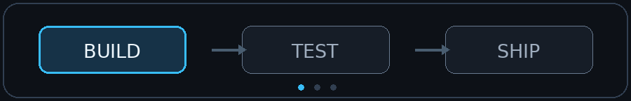

<div align="center">

# Hey, I'm Eslam Kamel 👋

### I build backends. They build character.

**Backend Engineer · Full-Stack Developer · SaaS Builder**



[](https://git.io/typing-svg)

[](https://islamdev.com)
[](https://www.linkedin.com/in/eslamkamel89/)
[](https://github.com/EslamKamel89)

*Welcome to my corner of GitHub. Please keep your hands inside the Docker container.*

[The human](#-the-human-behind-the-endpoints) · [The toolbox](#-my-toolbox) · [The process](#-build-test-ship-investigate) · [Side quests](#-current-side-quests)

</div>

---

## 🧑‍💻 The human behind the endpoints

I'm a **backend-focused full-stack developer** who turns complicated business workflows into usable products. APIs, databases, background jobs, authentication, deployment pipelines: basically everything that gets blamed when the button stops working.

I build with **Python (Django, FastAPI)** and **PHP (Laravel)**, publish **Flutter apps**, and explore **LLMs, RAG, and AI agents** that do useful work. A chatbot that confidently invents your refund policy is technically a feature. Just a very expensive one.

My happy place: **multi-tenant SaaS**, clear system boundaries, and software the next developer can maintain without opening a missing-person investigation.

```python
class EslamKamel:
    stack = ("Python", "Django", "FastAPI", "Laravel", "Flutter")
    interests = ("SaaS", "RAG", "AI agents", "DevOps")

    def build(self, idea):
        return {
            "architecture": "boring in all the right places",
            "tests": "because vibes are not a test suite",
            "deployment": "docker compose up -d",
            "documentation": "a gift to future me, who remembers nothing",
        }

    def debug(self, bug):
        return "Check the logs. Question assumptions. Then check the logs again."
```

> **My engineering philosophy:** Be clever enough to solve the problem. Be kind enough to leave readable code. Future me is tired and has questions.

## 🧰 My toolbox


<div align="center">

**Backend & APIs**


**Data, AI & orchestration**


**Infrastructure & quality**


**Frontend & mobile**


</div>

## 🔁 Build. Test. Ship. Investigate.

<div align="center">



*The goal is a boring release. I save the drama for variable names.*

</div>

| Step | What I actually do | What my inner monologue says |
| --- | --- | --- |
| 🧭 Understand | Map the domain and business rules. | “Before we add AI, what does the button do?” |
| 🧱 Design | Define contracts, boundaries, and failure modes. | “What if the user clicks it twice? They will.” |
| 🛠️ Build | Ship practical APIs, jobs, and interfaces. | “This abstraction could have been a function.” |
| 🧪 Verify | Test behavior and challenge assumptions. | “Happy path? Lovely. Now unplug something.” |
| 🚀 Deploy | Bring Docker, CI/CD, and observability along. | “May your logs be useful and your pager silent.” |

## 🌱 Current side quests

```text
Multi-tenant SaaS    → Keeping tenants isolated. Like good neighbors.
LLMs + RAG          → Giving AI receipts before giving it responsibility.
AI agents           → Automating workflows, supervising the enthusiasm.
DevOps              → Making “release day” sound less like a disaster movie.
Flutter apps        → Yes, the backend person is touching the pixels again.
Embedded systems    → Long-term curiosity. Smaller computers, same questions.
```

<details>
<summary><b>🐛 Open the totally official developer FAQ</b></summary>

### Why backend?

I enjoy building the systems behind the interface. Also, databases rarely ask me to make the logo bigger.

### Do you do frontend too?

Yes: Flutter, Livewire, Vue, React, and Tailwind. I can center a div. I may need a moment of silence first.

### Tabs or spaces?

Whatever the formatter says. I choose my battles, and whitespace has home-field advantage.

### What's your debugging superpower?

Asking “What assumption did I make?” Usually followed by “Ah. That one.”

### Can we add just one small feature?

Of course. Let’s meet its twelve undocumented business rules first.

</details>

## 📈 The commit plot thickens

<div align="center">

### 🐍 I write code. The snake eats the evidence.

<picture>
  <source media="(prefers-color-scheme: dark)" srcset="https://raw.githubusercontent.com/EslamKamel89/EslamKamel89/output/github-contribution-grid-snake-dark.svg" />
  <source media="(prefers-color-scheme: light)" srcset="https://raw.githubusercontent.com/EslamKamel89/EslamKamel89/output/github-contribution-grid-snake.svg" />
  
</picture>

*An entire year of contributions. One very hungry code reviewer. Zero respect for my green squares.*

<sub>Generated from my GitHub contribution calendar with <a href="https://github.com/Platane/snk">Platane/snk</a> and refreshed daily by <a href="https://github.com/EslamKamel89/EslamKamel89/actions/workflows/contribution-snake.yml">GitHub Actions</a>. The snake has a better meal schedule than I do.</sub>

<!-- Animation assets are published to the output branch on the first workflow run after pushing the workflow to main. To refresh manually: Actions → Feed the contribution snake → Run workflow. -->


*Commits are activity, not a personality test. Some of my best work is deleting code.*

<sub>Live typing, badges, and streak stats use external services; they may occasionally take a coffee break. The terminal and workflow animations live in this repo.</sub>

</div>

---

<div align="center">

## 🤝 Got a product idea with suspiciously few requirements?

**Let's turn it into something real.** Backend, SaaS, mobile, or AI-powered workflows—I'm interested in the problems behind the pitch deck.

**[Explore my portfolio](https://islamdev.com) · [Connect on LinkedIn](https://www.linkedin.com/in/eslamkamel89/) · [Browse my code](https://github.com/EslamKamel89)**


**Thanks for scrolling. You have successfully completed onboarding.** 🎉

<sub>No production databases were harmed in the making of this README.</sub>

</div>
